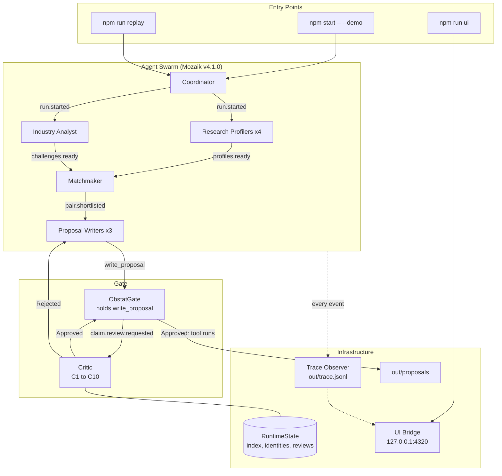

<div align="center">

  # 📜 Obstat

  **The Gated Multi-Agent Matchmaker**

[](https://www.npmjs.com/package/@mozaik-ai/core) [](https://build.jigjoy.ai/tracks/einstein) [](#usage) [](./test) [](https://github.com/jigjoy-ai/einstein-matchmaker-data)

<p align="center">
  No proposal leaves a writer until a separate Critic has checked every claim against the person it names.<br/>
  Research collaboration proposals for the EINSTEIN network, every claim tied to a dataset record.<br/><br/>
</p>

<p align="center">
  <b><a href="#usage">Run It</a></b> | <b><a href="#system-architecture">System Architecture</a></b> | <b><a href="./out/proposals/pair-2.md">Read a Proposal</a></b> | <b><a href="./out/trace.jsonl">Full Trace</a></b>
</p>

<p align="center">
  
  
  
  
  
</p>

</div>

---

## Overview

**Obstat reads the EINSTEIN dataset and writes collaboration proposals between University of Novi Sad researchers and companies around NTP Novi Sad.** The dataset is messy on purpose: one person is stored twice under different spellings, two people share a name, profiles go stale, and some notes describe someone else. When the work is split across agents, the writer holding a profile loses the context needed to tell people apart. So Obstat does not trust its writers: every `write_proposal` call is intercepted and held until a separate Critic has checked each claim against the records themselves.

- **The Gate**: `ObstatGate`, a Mozaik `InterceptionHandler`, holds only the writer whose `write_proposal` it caught, while every other loop keeps running.
- **The Critic**: ten checks (C1–C10) on every claim: the ID exists, the record really credits the named researcher, duplicate profiles, namesakes, availability, capacity, research fit, complete sections, no ranking of people, and support.
- **Identity Hints**: names normalized across Serbian Cyrillic and Latin, diacritics and reversed order, so `R0139` "Jeremić Mirjana" and `R0539` "Mirjana Jeremić" are found to be one person.
- **Agent Swarm**: a Coordinator, four Research Profilers, an Industry Analyst, a Matchmaker, three Proposal Writers, the Critic and a Trace Observer. No agent calls another; every hand-off is an event.
- **Code-First Retrieval**: candidates for each challenge come from TF-IDF over researchers' own works, so models judge a shortlist instead of reading 7 million tokens.
- **Fails Closed**: a Critic that does not answer within 90 s returns the writer to `inference` with nothing written. The gate never returns `idle`.
- **Round Cap and Replacement**: after three failed rounds the writer drops the failing claims; if a final round fails, the pair is abandoned and the Matchmaker finds a replacement.
- **Replay Without a Key**: `npm run replay` runs the same runtime with every model call answered from the committed run's recording, and proves it reproduces the run word for word.
- **Concurrency Proof**: `npm run proof` computes, from the trace alone, how many loops ran at once and what the other writers did during each hold.
- **Read-Only Terminal**: a web console and landing page that replay the run: the timeline of holds, every verdict, and every record a claim cites.

### Plugging Into EINSTEIN

[EINSTEIN](https://cordis.europa.eu/project/id/101136377) is a Horizon Europe project (2024–2028) coordinated by the University of Novi Sad, with a consortium of nine institutions in Serbia, Austria, the Netherlands and Denmark. Its stated mission includes knowledge management and technology transfer. Obstat is a technology-transfer tool for that university and the companies around NTP Novi Sad.

- **Where It Sits**: between the university's researchers and the park's companies. It reads both sides, turns away challenges that are not research, and hands EINSTEIN staff proposals they can check line by line, instead of a list of names.
- **What It Reads**: any source of researcher profiles with IDs for publications, projects and patents. EINSTEIN's own [EINSTEIN Score](https://einsteineuproject.com/platforms/einstein-score/) keeps exactly such profiles. Obstat would read the profiles and deliberately ignore the scores: it proposes collaborations and never ranks people.
- **What It Hands Over**: each proposal as Markdown for a person and JSON for a system, every claim mapped to the dataset IDs it rests on, with the Critic's verdict and a trace of who checked what, and when.
- **What It Guards**: the identity problems a network of many institutions creates: one person under two spellings or scripts, two people with one name, profiles that went stale.
- **EINSTEIN Stars**: not defined in the track brief, the dataset or the project's public site, so this README does not guess at it. If it names a set of researchers EINSTEIN features, Obstat takes it as one more source of profiles, checked like any other, and never uses it to rank anyone.

### Responsible Data

- **No Ranking of People**: Obstat proposes collaborations; C9 fails ranking language in every claim and section, and lists sort by ID or time.
- **Every Claim Cited**: each claim carries dataset IDs, and the Critic checks each one against the record before anything is written.
- **Dataset Only**: no outside data. The EINSTEIN dataset is synthetic; its people, companies and publications are invented.

## System Architecture

Obstat is built on [Mozaik](https://www.npmjs.com/package/@mozaik-ai/core) `4.1.0`, pinned and checked at startup. Every participant is created with `createAgent` or `createHuman` and reacts to events through situation handlers; shared state lives in a `RuntimeState` subclass.

For the full design, see:

- **[Product Requirements](./prd.md)**
- **[01. The Gate](./src/gate/obstat-gate.ts)**
- **[02. The Critic's Checks](./src/critic/checks/)**
- **[03. Identity Hints](./src/data/identities.ts)**
- **[04. The Agents](./src/participants/)**
- **[05. Replay](./src/replay/replay-runner.ts)**
- **[06. Frontend Spec](./docs/FRONTEND.md)**



### Monorepo Structure

Two packages: the runtime at the root, and the frontend in `ui/` with its own `package.json`, so a frontend build failure cannot break `npm start`.

| Package | Layer | Responsibility |
|---|---|---|
| `src/data` | Data | Loads the dataset once into memory; name normalization, identity hints, candidate retrieval |
| `src/gate`, `src/critic` | Gate | Holds every `write_proposal` call and runs C1–C10 on it |
| `src/participants` | Agents | Coordinator, Profilers, Analyst, Matchmaker, Writers, Trace Observer |
| `src/ui-bridge`, `src/replay`, `src/proof` | Tools | The terminal's read endpoints, replay from the recording, the concurrency proof |
| `ui` | Frontend | The landing page and the read-only terminal |

### Concurrency Proof

`npm run proof` on the committed trace:

```text
Most writer loops at once: 3. Most profiler loops at once: 4.

rv_01  W1 held 25.9 s (18:24:58.9–18:25:24.8), pair-1 round 1: fail: claim 5 C5
  active meanwhile: AN classifying batch 3 of 3; W2 writing pair-2; W3 writing pair-3
rv_03  W2 held 1.1 s (18:25:57.2–18:25:58.3), pair-2 round 1: fail: proposal C3, claim 4 C2, claim 4 C3, …
  active meanwhile: W1 writing pair-1; W3 writing pair-3
  work done meanwhile: W3 held, W3 model turn

PASS  at least 3 writer loops ran at once (T7)
PASS  at least 2 profiler loops ran at once (T7)
PASS  at least 2 other writer loops were active during one hold (PRD §17)
```

## Usage

Obstat runs from the project folder with npm. No API key is needed to see it work:

```bash
npm run replay
```

This runs the whole swarm again, with every model call answered from [`out/recording.jsonl`](./out/recording.jsonl). Writer 2 works from researcher `R0139`'s profile, which lists `SYN-PUB-01827`, but that paper's author entry carries `R0539`: one person, stored twice. The gate holds it:

```text
18:24:55.2  MM  pair-2: R0139 with C062-CH1 (industrial_phd)
18:24:55.2  W2  writing pair-2
18:25:57.2  W2  HELD write_proposal held (6 claims) [rv_03]
18:25:57.3  W3  HELD write_proposal held (6 claims) [rv_04]
18:25:58.3  CR  rv_03 claim 4 FAIL C2: SYN-PUB-01827's author entries carry R0539, not R0139.
18:25:58.3  CR        claim 4 FAIL C3: SYN-PUB-01827 is attributed to R0539. R0139 and R0539 look like one person (…
18:25:58.3  W2  -> inference (revising)
18:25:58.7  W1  HELD write_proposal held (8 claims) [rv_05]
18:26:25.3  CR  PASS rv_05 (pair-1 round 2)
18:26:57.9  W2  HELD write_proposal held (6 claims) [rv_07]
18:26:59.4  CR  PASS rv_07 (pair-2 round 2)
18:26:59.4  W2  proposals/pair-2.md written
```

It ends with "The replay reproduces the committed run." To run it live with your own Gemini key:

```bash
npm start -- --demo
```

Then open the terminal on the run:

```bash
npm run ui
```

Open http://127.0.0.1:4320, click **Open terminal**, then the hold `rv_03`:


### Other Commands

- `npm run proof`: recomputes the concurrency proof from `out/trace.jsonl`.
- `npm run doctor`: makes one live tool-calling round per configured model, to check a key before a full run.
- `npm run identities`: prints the duplicate profiles, namesakes and stale profiles found in the dataset.
- `npm run ui:build`: installs and builds the frontend in `ui/` (once, before `npm run ui`).
- `npm run ui -- --port <n>`: serves the frontend on another port.
- `npm test`: runs 42 tests with no key, including a whole offline run and the replay of the committed run.
- `npm run check`: type-checks the runtime.

## Committed Run

The run in `out/` wrote three proposals for three different pairs and turned 135 of 489 challenges away, in 23 model calls on `gemini-3.5-flash-lite`.

**[Industrial PhD: Mirjana Jeremić (R0539) with Terramap Subotica](./out/proposals/pair-2.md)** | **[Industrial PhD: Maja Popović (R0906) with CardioTrack](./out/proposals/pair-1.md)** | **[Joint project: Ivona Bogdanović (R0269) with ReVita Water](./out/proposals/pair-3.md)**

**[Run Summary](./out/summary.md)** | **[Challenges Turned Away](./out/no-match.md)** | **[Full Trace](./out/trace.jsonl)**

### Known Limits

- **The Demo Pair Is Seeded**: the Matchmaker merges second records into their canonical person, so on its own it would pair `R0539`, not `R0139`. `--demo` seeds `R0139` with `C062-CH1`, as PRD F5 allows; the hold that follows is real.
- **Writers Work From a Dossier**: the profile as the profile states it, not the author entries. Checking attribution is the Critic's job; that is the point of the gate.
- **Small Models**: the committed run used Gemini's free tier. Writers sometimes leave out required fields; the gate rejects those calls before review without using up a round.
- **Identity Hints Need Evidence**: two records with one name and one faculty but no shared works stay two people. A missed merge is the safe failure, because C2 still checks the exact ID on every record.
- **Replay Is Exact or It Misses**: answers are keyed by a hash of the whole request, so any change to a prompt, gate message or dossier breaks the replay of this run, and `npm run replay` reports the misses rather than inventing answers.
- **Gemini Needs a Patch**: Mozaik 4.1.0 drops Gemini's thought signatures, which Gemini 3 requires on the next turn of a tool call; [`src/providers.ts`](./src/providers.ts) keeps them.

## Local Development

Want to run it yourself or change it? Here's how to set up the project locally.

### Prerequisites

- Node.js >= 22.6
- npm >= 10

### Setup

1. **Clone the repository:**
   ```bash
   git clone https://github.com/Dotman-Bei/Obstat.git
   cd Obstat
   ```
2. **Install dependencies and get the dataset:**
   ```bash
   npm install
   git clone https://github.com/jigjoy-ai/einstein-matchmaker-data data
   ```
3. **Set up Environment Variables:**
   Only a live run needs a key. Copy `.env.example` to `.env` and add a Gemini key. Models, rate limits and the token budget are in [`src/config.ts`](./src/config.ts); put overrides in `obstat.config.json`.
   ```env
   GEMINI_API_KEY=...
   ```
4. **Build the frontend:**
   ```bash
   npm run ui:build
   ```

### Running Locally

To run the full swarm with live models:

```bash
npm start -- --demo
```

*(A run takes about 5 minutes and roughly 20 model calls, which fits Gemini's free tier. It writes `out/proposals/`, `out/trace.jsonl`, `out/summary.md` and `out/no-match.md`.)*

## Contributing

Want to add a check, a data source or an agent (a check for expired funding calls, or a reader for a second researcher database)? Contributions are welcome.

1. Fork the Project
2. Create your Feature Branch (`git checkout -b feature/AmazingFeature`)
3. Run the tests (`npm test`)
4. Push to the Branch (`git push origin feature/AmazingFeature`)
5. Open a Pull Request

## Community & Support

- **Hackathon**: the [EINSTEIN track](https://build.jigjoy.ai/tracks/einstein) of the NTP Novi Sad Hackathon, 30–31 October 2026.
- **Dataset**: the [EINSTEIN Matchmaker dataset](https://github.com/jigjoy-ai/einstein-matchmaker-data), synthetic researchers and companies.
- **EINSTEIN Project**: the [project's website](https://einsteineuproject.com/).
- **Mozaik**: the [`@mozaik-ai/core`](https://www.npmjs.com/package/@mozaik-ai/core) package on npm.
- **Issue Tracker**: report a bug in [GitHub Issues](https://github.com/Dotman-Bei/Obstat/issues).

---

<div align="center">
  <i>Built with Mozaik 💖</i>
</div>
