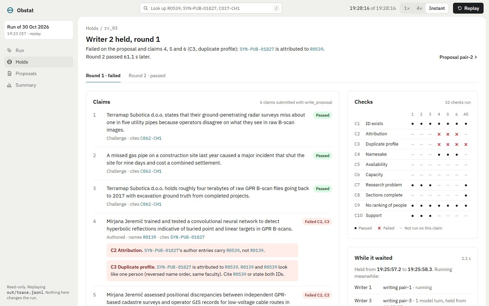

# Obstat

**No proposal leaves a writer until a separate Critic has checked every claim against the person it names.**

```
                 ┌──────────────── RuntimeState (shared) ─────────────────┐
                 │ index · identities · shortlist · commitments · reviews │
                 └────────────────────────────────────────────────────────┘
Coordinator     ──► run.started (shard plan)
Profilers P1..P4 ──► profiles.ready: identity hints per shard  (concurrent)
Industry Analyst ──► challenges.ready: research / not_research / no_uns_fit, in batches
Matchmaker      ──► pair.shortlisted: researcher × challenge, with evidence IDs
Writers W1..W3  ──► write_proposal(...)                         (concurrent, one pair each)
                      │
                      ▼  ObstatGate.isSatisfiedBy(function_call write_proposal)
                   HOLD W_k only ── claim.review.requested ──► Critic (C1–C10)
                      ▲                                           │
                      └──── verdict, matched by reviewId ◄── claim.review.completed
                   pass → the tool runs → out/proposals/<pair>.md
                   fail → FunctionCallOutputItem(failures) → "inference" → W_k revises
Trace Observer  ──► out/trace.jsonl (every event, loop IDs, holds, verdicts)
```

The demo hold from the committed run ([`out/trace.jsonl`](out/trace.jsonl)). Writer 2 works from researcher R0139's profile, which lists SYN-PUB-01827. That paper's author entry carries R0539: one person, stored twice.

```
18:24:55.2  MM  pair-2: R0139 with C062-CH1 (industrial_phd)
18:24:55.2  W2  writing pair-2
18:25:57.2  W2  HELD write_proposal held (6 claims) [rv_03]
18:25:57.3  W3  HELD write_proposal held (6 claims) [rv_04]
18:25:58.3  CR  rv_03 proposal FAIL C3: researcherIds lists a second record: R0139 is a second record of R0539. …
                claim 4 FAIL C2: SYN-PUB-01827's author entries carry R0539, not R0139. | claim 4 FAIL C3: SYN-PUB-01827
                is attributed to R0539. R0139 and R0539 look like one person (reversed name order, same faculty). …
18:25:58.3  W2  -> inference (revising)
18:25:58.7  W1  HELD write_proposal held (8 claims) [rv_05]
18:26:25.3  CR  PASS rv_05 (pair-1 round 2)
18:26:57.9  W2  HELD write_proposal held (6 claims) [rv_07]
18:26:59.4  CR  PASS rv_07 (pair-2 round 2)
18:26:59.4  W2  proposals/pair-2.md written
```

## How to run

```bash
npm install
git clone https://github.com/jigjoy-ai/einstein-matchmaker-data data   # the EINSTEIN dataset
cp .env.example .env                                                    # then put your GEMINI_API_KEY in it
npm start -- --demo
```

`--demo` seeds the R0139 pair so the run shows a hold on a known trap (see [Known limits](#known-limits)). A run takes about 5 minutes and roughly 20 model calls on `gemini-3.5-flash-lite`, which fits Gemini's free tier. Models, rate limits and the token budget are in [`src/config.ts`](src/config.ts); put overrides in `obstat.config.json`.

**Without a key**, everything the run produced is committed:

- the three proposals: [pair-1](out/proposals/pair-1.md), [pair-2](out/proposals/pair-2.md), [pair-3](out/proposals/pair-3.md)
- [`out/trace.jsonl`](out/trace.jsonl): every event of the run
- [`out/summary.md`](out/summary.md) and [`out/no-match.md`](out/no-match.md)



`npm run ui:build && npm run ui` serves Obstat at http://127.0.0.1:4320: a landing page, and the terminal (the read-only console) on the committed run behind its Open terminal button. `npm run proof` recomputes the concurrency proof from the committed trace. `npm test` runs 41 tests with no key, including a whole `npm start` pass against the real dataset with a stand-in model.

## What it does

Obstat reads the EINSTEIN dataset (1,047 researchers, 10,779 publications, 1,823 projects, 111 patents, 153 companies with 489 challenges) and writes collaboration proposals between University of Novi Sad researchers and companies around NTP Novi Sad. Each proposal ends with a claim → dataset ID table and the Critic's verdict on every claim.

The dataset is messy on purpose. One person is stored twice under different spellings, two people share a name, profiles go stale, and some notes describe someone else. When the work is split across agents, the writer holding a profile loses the context needed to tell people apart. So Obstat does not trust its writers: every `write_proposal` call is intercepted and held until a separate Critic has checked each claim against the records themselves.

The committed run proposed three pairs:

| Pair | Researcher | Company and challenge | Released |
|---|---|---|---|
| [pair-1](out/proposals/pair-1.md) | Maja Popović (R0906) | CardioTrack: false atrial-fibrillation alarms from motion (C091-CH1) | round 2 |
| [pair-2](out/proposals/pair-2.md) | Mirjana Jeremić (R0539) | Terramap Subotica: missed pipes in GPR B-scans (C062-CH1) | round 2, after the R0139 hold |
| [pair-3](out/proposals/pair-3.md) | Ivona Bogdanović (R0269) | ReVita Water: membrane fouling in dairy wastewater (C088-CH2) | round 2 |

It turned 135 challenges away before matching, each with a reason: hiring, grants, legal, sales, and one with no fitting researcher.

## Architecture and roles

Built on [Mozaik](https://www.npmjs.com/package/@mozaik-ai/core) `4.1.0` (pinned; the run checks it at startup). Every participant is created with `createAgent` or `createHuman` and reacts to events through situation handlers. No participant calls another; every hand-off is an event.

| Participant | Does | Model |
|---|---|---|
| Coordinator | Sends `run.started` with the shard plan; ends the run when every pair is settled | none |
| Research Profiler ×4 | Profiles one shard: second records, namesakes, stale status, notes that describe someone else (computed in code), then writes a brief | small |
| Industry Analyst | Classifies every challenge as `research`, `not_research` or `no_uns_fit`, with a reason, in three batches; each challenge comes with its closest researchers from code retrieval | small |
| Matchmaker | Shortlists pairs from code-retrieved candidates, with evidence IDs; finds a replacement when a pair is abandoned | small |
| Proposal Writer ×3 | Writes one proposal from the pair's dossier by calling `write_proposal`; revises when the gate returns failures | small |
| Critic | Runs the check catalogue on each held call and answers with a verdict per claim | code; a model only for C10 |
| Trace Observer | Writes one JSON line per event to `out/trace.jsonl` and a readable line to the terminal | none |

**The gate** ([`src/gate/obstat-gate.ts`](src/gate/obstat-gate.ts)) is an `InterceptionHandler` passed to `runLoop` for every writer loop. It holds only that writer's loop, sends `claim.review.requested`, and awaits the verdict, matched by review ID, never by event order. A pass lets the tool run. A fail goes back to the writer as a `FunctionCallOutputItem` and the loop returns to `inference`. It never returns `idle`. If the Critic does not answer within 90 s, the gate fails closed. After three failed rounds the writer is told to drop the failing claims; if a final round still fails, the pair is abandoned and the Matchmaker finds a replacement. The `write_proposal` tool itself also refuses to write anything the Critic did not pass.

**The Critic's checks** ([`src/critic/checks/`](src/critic/checks)) are plain code, except C10:

| | Check | Fails when |
|---|---|---|
| C1 | ID exists | a cited ID is not in the dataset, or the challenge is not the company's |
| C2 | Attribution | the cited record's author, inventor or participant entries do not carry the named researcher ID |
| C3 | Duplicate profile | the claim names a second record of a person; the verdict names the canonical ID |
| C4 | Namesake | the evidence belongs to a different person with the same name |
| C5 | Availability | no quote from the researcher's own `open_to` or notes supports the role; they left; they are emeritus and the role is not consulting; the claim relies on a past date |
| C6 | Capacity | commitments already passed exceed what the researcher's note allows |
| C7 | Research problem | the Analyst classified the challenge `not_research` or `no_uns_fit` |
| C8 | Sections complete | a required section is missing, a marker points at no claim, or a claim is a pasted paragraph |
| C9 | No ranking of people | worth language about people ("best researcher", "top-ranked") |
| C10 | Support | a small model, given only the cited records, judges they do not support the sentence |

Identity hints ([`src/data/identities.ts`](src/data/identities.ts)) are computed once. Names are normalized (Serbian Cyrillic to Latin, diacritics, reversed order), and two records count as one person only with the same normalized name, the same faculty (in either language) and record evidence. They find all three duplicates in the dataset (R0139 → R0539, R0556 → R0976, R0894 → R0929) and both namesake pairs. Run `npm run identities` to see them.

## How agents run concurrently

Every Mozaik loop runs on its own; the gate's `await` holds only the writer whose call it intercepted. `npm run proof` on the committed trace:

```
Most writer loops at once: 3. Most profiler loops at once: 4.

rv_01  W1 held 25.9 s (18:24:58.9–18:25:24.8), pair-1 round 1: fail: claim 5 C5
  active meanwhile: AN classifying batch 3 of 3; W2 writing pair-2; W3 writing pair-3
  work done meanwhile: W2 held, W2 model turn
rv_03  W2 held 1.1 s (18:25:57.2–18:25:58.3), pair-2 round 1: fail: proposal C3, claim 4 C2, claim 4 C3, …
  active meanwhile: W1 writing pair-1; W3 writing pair-3
  work done meanwhile: W3 held, W3 model turn

PASS  at least 3 writer loops ran at once (T7)
PASS  at least 2 profiler loops ran at once (T7)
PASS  at least 2 other writer loops were active during one hold (PRD §17)
```

## How Obstat plugs into the EINSTEIN network

[EINSTEIN](https://cordis.europa.eu/project/id/101136377) is a Horizon Europe project (2024–2028) coordinated by the University of Novi Sad, with a consortium of nine institutions in Serbia, Austria, the Netherlands and Denmark. Its stated mission includes knowledge management and technology transfer. Obstat is a technology-transfer tool for that university and the companies around NTP Novi Sad:

- **Where it sits.** Between the university's researchers and the park's companies. It reads both sides, turns away challenges that are not research, and hands EINSTEIN staff proposals they can check line by line, instead of a list of names.
- **What it reads.** Any source that holds researcher profiles with IDs for publications, projects and patents. EINSTEIN's own [EINSTEIN Score](https://einsteineuproject.com/platforms/einstein-score/) platform keeps exactly such profiles (publications, projects, patents, ORCID). Obstat would read the profiles and deliberately ignore the scores: it proposes collaborations and never ranks people.
- **What it hands over.** Each proposal is Markdown for a person and JSON for a system, with every claim mapped to the dataset IDs it rests on and the Critic's verdict. The trace records who checked what, and when, so a staffer can open any cited record and see the check that passed it.
- **What it guards.** The identity problems a network of many institutions creates: one person under two spellings or scripts, two people with one name, and profiles that went stale. The gate stops a proposal before any of these reach a company.

*EINSTEIN Stars* is not defined in the track brief, the dataset or the project's public site, so this README does not guess at it. If it names a set of researchers EINSTEIN features, Obstat takes it as one more source of profiles, checked like any other; it does not use it to rank anyone.

## Responsible data

- Obstat proposes collaborations. It never scores or ranks people. C9 fails ranking language in every claim and section, and lists sort by ID or time.
- Every claim cites dataset IDs, and the Critic checks each one against the record before anything is written.
- No data beyond the dataset is used. The dataset is synthetic; its people, companies and publications are invented.

## Known limits

- **The demo pair is seeded.** The Matchmaker merges second records into their canonical person, so on its own it would pair R0539, not R0139, and the trap would never reach a writer. `--demo` seeds R0139 with C062-CH1, as PRD F5 allows. The hold that follows is real: the writer, the gate and the Critic all run unchanged.
- **Writers work from a dossier, not the records.** The dossier gives the profile as the profile states it, including the works it lists, but not author entries. Checking attribution is the Critic's job; that is the point of the gate.
- **Small models throughout**, because the committed run used Gemini's free tier. Writers on `gemini-3.5-flash-lite` sometimes leave out required fields. The gate rejects those calls before review without using up a round. The Analyst chose `no_uns_fit` only once.
- **Identity hints need record evidence.** Two records with one name and one faculty but no shared works stay two people. A missed merge is the safe failure, because C2 still checks the exact ID on every record.
- **Replay without a key is partial.** Every model output is recorded to `out/recording.jsonl`, but there is no `npm run replay` that re-runs the runtime from it yet. The no-key path is the committed outputs, `npm run ui` and `npm run proof`.
- **The console shows finished runs.** There is no live view of a run in progress (`npm start -- --ui`) yet.
- **Gemini needs a patch.** Mozaik 4.1.0 drops Gemini's thought signatures, which Gemini 3 requires on the next turn of a tool call. [`src/providers.ts`](src/providers.ts) keeps them; `npm run doctor` checks a live tool round trip.

## Console

```bash
npm run ui:build   # once: installs and builds ui/
npm run ui         # http://127.0.0.1:4320: the landing page; Open terminal replays out/trace.jsonl
                   # (the terminal itself is /console.html; add --out <dir> for another run)
```

A read-only window onto a finished run, with no key and no model calls:

- **Run:** one lane per participant, with each hold marked. Point at a hold to see which other loops were running at that moment.
- **Hold detail:** each claim with the Critic's reason, every check C1–C10 per claim, and what the writer changed between rounds.
- **Record drawer:** opens any cited ID, with the field that decided the check highlighted.
- **Proposals and summary.**

Replay runs in the browser at 1×, 4× or instant. The server ([`src/ui-bridge/`](src/ui-bridge)) binds to 127.0.0.1 only and serves the trace, the proposals and records from the dataset index. Removing it changes nothing about the run. The design is in [`docs/FRONTEND.md`](docs/FRONTEND.md). `cd ui && npm run dev` still serves the console on a built-in sample trace, for design work.
